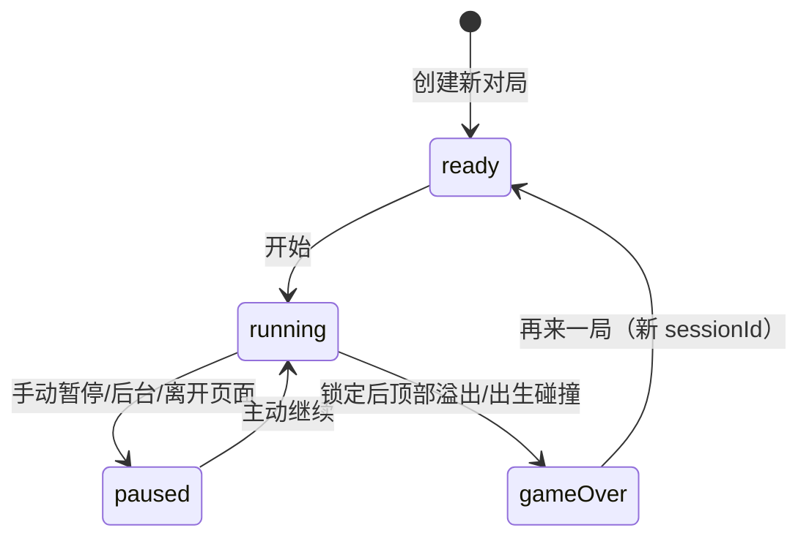

# 游戏引擎设计

基线：[需求文档](../需求文档.md) · 参数为首版实施设计，不依赖 UI 或平台 API。

## 1. 坐标与棋盘

- 可见棋盘 10×20，逻辑增加顶部 2 行隐藏缓冲，共 10×22。
- 逻辑坐标 x 为 0–9、y 为 0–21，向右／向下为正；可见行 y 为 2–21。
- 棋盘只存已锁定单元格，每格为 `null` 或七种方块类型；活动方块单独保存，落点由碰撞推导，不写入棋盘。
- 占格坐标来自形状矩阵的非空格加方块原点；碰撞只检查非空格，不检查矩阵空白区。
- 占格越过上述逻辑边界或覆盖非空单元格即非法。

## 2. 方块矩阵与生成

出生方向如下，`.` 表示空白；I 使用 4×4、O 使用 2×2，其余使用 3×3。出生原点 `x = floor((10 - 矩阵宽度)/2)`、`y = 1`，保证出生实体至少部分可见。

```text
I       O     T      S      Z      J      L
....    ##    .#.    .##    ##.    #..    ..#
####    ##    ###    ##.    .##    ###    ###
....          ...    ...    ...    ...    ...
....
```

矩阵按顺时针绕自身中心旋转，索引转换为 `(x, y) → (n-1-y, x)`。预计算四种方向，不在每次绘制时重建。O 方向固定为 0。

采用七袋随机：每袋包含七种类型各一个，以 Fisher–Yates 洗牌后逐个取出；袋空时再生成。维护可序列化的 32 位非零随机状态，使用固定算法与版本，不在引擎内调用不可重放的全局随机函数。无界随机整数到有界索引需使用拒绝采样避免取模偏差。种子只在新对局由外层提供。

存档保存剩余袋顺序与随机状态，不因恢复、渲染或计算落点消耗随机数。内部袋不是下一块预览，不在界面展示。

## 3. 旋转与位置补偿

首版使用项目自定义简化补偿，不声称兼容完整 SRS。尝试目标方向后，按下列顺序逐个检测位置，第一项合法则成功，全部失败则不变：

| 类型 | 相对偏移 `(dx,dy)`，按优先顺序 |
| --- | --- |
| T/S/Z/J/L | `(0,0), (-1,0), (1,0), (0,-1), (-1,-1), (1,-1), (0,-2)` |
| I | `(0,0), (-1,0), (1,0), (-2,0), (2,0), (0,-1), (0,-2)` |
| O | 无动作，不发旋转成功事件，不重置触底计时 |

不允许向下补偿或穿越堆积格。每个起始方向使用相同优先表，行为可预测且可测试。后续若需完整标准旋转，必须更换规则版本并补齐相应测试。

## 4. 核心状态与命令契约

状态包含：`sessionId`、递增 `revision`、`phase`、棋盘、活动方块（类型／方向／原点／pieceId）、分数、袋与随机状态、重力剩余时间、触底剩余时间、锁定重置次数。

| phase | 含义 |
| --- | --- |
| ready | 新对局等待首次提示完成或开始 |
| running | 接受游戏命令和时钟推进 |
| paused | 完全冻结，等待主动继续 |
| gameOver | 已结算，不再接受棋盘操作 |

命令：开始、继续、暂停、左移、右移、顺时针旋转、普通下移、快速落底，以及由控制层提供的时间推进。操作命令携带对局与方块身份；不匹配则忽略，不加分、不发反馈。

纯函数契约为 `transition(state, command) → { state, events }`。函数不读系统时钟、不写数据库、不播放反馈。无效操作不改变 revision；成功的状态变化递增 revision。事件携带 sessionId、revision、序号，供外层去重。



恢复有效存档统一进入 paused，不恢复为 running。消行动画不是规则状态，不存在需要恢复一半的消行阶段。

## 5. 时间推进与锁定

初值：重力间隔 1000ms，锁定延迟 500ms，最多重置 8 次。时间由控制层的单调时钟提供；引擎只消费运行状态下的时间增量。

- 自动重力每次尝试下移 1 格，成功不加操作分，触底时启动锁定倒计时。
- 首次进入触底时设置 500ms；触底状态指当前位置合法且向下 1 格非法。
- 成功横移或非 O 旋转时，若此前或此后触底且重置次数未达上限，则重置为 500ms 并消耗一次重置次数；失败动作不重置。
- 离开支撑时停止扣减锁定时间，但保留该方块剩余时间及重置次数；再次触底不自动获得新的 500ms。若剩余时间已耗尽，再触底立即锁定。
- 第 8 次重置后仍允许合法移动和旋转，但不再延长倒计时；仅按剩余时间扣减。
- 成功普通手动下移立即按格加分，并重置重力剩余时间为 1000ms；不消耗横移／旋转的锁定重置次数。
- 快速落底计算最大合法下移距离，移动并立刻锁定，忽略锁定延迟。
- 暂停保存计时剩余量；继续重新建立时钟基线，不扣减暂停或后台时间。

处理时间增量时按下一次重力／锁定到期的时间点分段推进，不先一次性扣完所有计时器。相同时间点锁定优先；锁定后的剩余前台时间可作用于新方块，但旧输入不可跨方块执行。明显异常的帧间隔由外层暂停处理，见架构文档。

## 6. 锁定、消行和结束的原子流程

一次锁定在同一引擎调用中完成，不被渲染或保存打断：

1. 校验活动方块与操作身份，仅锁定一次。
2. 将活动格写入棋盘，基础分 +10；快速落底先结算本次实际距离 ×2。
3. 查找所有满行（包括隐藏行），一次删除，并在顶部补等量空行。
4. 按本次消行数加 100／300／500／800；不把多行拆成多次单行分。
5. 消行后隐藏行仍有占格，则判定顶部溢出并结束；这是隐藏缓冲行的必要边界细化，避免产生无法看见的存活堆积。
6. 未溢出时，从袋中取下一类型，生成新 pieceId，重置该方块计时与重置次数。
7. 出生位置碰撞则结束，否则继续运行。
8. 返回完整状态与锁定、消行、得分变化、生成或结束事件。

结束时 active 为 null，最后一块已取得的基础分和消行分保留。失败生成不额外增加基础分。显示层拿到消行前行位置和结果后可做 120ms 过渡；规则已提交，不允许动画结束回调再次消行或计分。

## 7. 落点与计分不变量

落点距离 d 从 0 开始，直到向下 d+1 格非法，取最大合法 d。落点渲染与硬降使用同一个函数，避免视觉与实际结果不一致。

- 分数为非负安全整数，普通操作无法减分；自然下落只在锁定时 +10。
- 普通下移按成功格数即时 +1，失败移动 +0；硬降只计算剩余距离 ×2。
- 未锁定方块的操作分属于本局分数，应随对局保存。
- 每个 pieceId 最多产生一次锁定事件和一次基础分。
- 落点计算、旋转预览和渲染不改变棋盘、分数或随机状态。
- 相同初始状态和命令／时间增量序列应得到相同终态及事件序列。

## 8. 必须验证的规则用例

覆盖需求 A02、A06–A10：七种形状四方向占格、左右／底边碰撞、补偿顺序与失败旋转、O 旋转无延时收益、隐藏行溢出、消行后解除顶部占格、七袋与恢复序列一致、1–4 行同时消除、0 格硬降、123 分示例、8 次重置上限、离开支撑再落地、暂停剩余计时、同时间点锁定优先，以及旧 pieceId 的命令全部失效。
