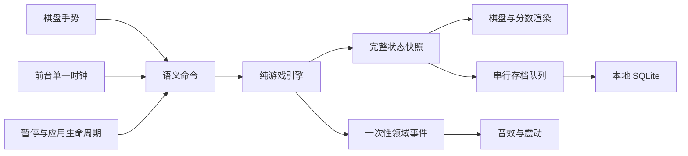

# Block Drop 设计总览

版本：v1.0 · 日期：2026-10-12 · 基线：[需求文档](../需求文档.md)

本设计服务于 Android 竖屏、离线单机、单手手势操作的休闲俄罗斯方块。本文档是待实现的方案，不表示对应功能已开发完成。

## 文档导航

| 文档 | 内容 | 主要用途 |
| --- | --- | --- |
| [界面与交互](./界面与交互设计.md) | 页面线框、视觉规范、布局、手势识别、弹层与反馈 | 开发界面、调试单手操作 |
| [游戏引擎](./游戏引擎设计.md) | 棋盘坐标、方块、随机、旋转、计时、锁定、计分、状态机 | 实现和验证游戏规则 |
| [技术架构与存档](./技术架构与存档设计.md) | 模块划分、依赖、数据契约、生命周期、保存恢复、测试计划 | 组织代码与保证续玩可靠性 |

## 设计决策

| 项目 | 方案 | 状态 |
| --- | --- | --- |
| 产品体验 | 固定慢速，无等级加速，无下一块预览和暂存 | 用户已确认 |
| 操作 | 点击旋转，左右拖动，普通下滑，快速下滑落底 | 用户已确认 |
| 计分 | 锁定 +10；普通下移 +1/格；快速下移 +2/格；消行 100/300/500/800 | 用户已确认 |
| 视觉 | 深灰背景、微圆角色块、柔和七色、轮廓落点 | 用户已确认 |
| 存储 | 本地 SQLite；对局、最高分和设置逻辑隔离 | 实施设计 |
| 引擎 | 纯 TypeScript、确定性状态转移、单一时钟 | 实施设计 |
| 随机 | 七袋随机与可序列化随机状态 | 实施设计 |
| 旋转 | 固定矩阵旋转与简化补偿表，不宣称完整标准 SRS | 实施设计 |
| 手势 | 方向锁定、距离换格、快速下滑一次触发、方块身份校验 | 实施设计 |

文中的自动下落 1000ms、触底 500ms、最多 8 次锁定重置、触摸距离和速度、配色与动画时长均为实施初值。先保证规则一致，再通过 Android 真机调整；不得调试时改变已确认的计分或新增模式。

## 系统关系

## 开发里程碑

1. **规则可验证**：完成引擎、确定性随机和关键边界用例，能够用命令重放对局。
2. **单手能玩**：完成棋盘、落点和四种手势，真机验证快速下滑与普通下滑的区分。
3. **可靠续玩**：完成页面、暂停、后台处理、持久化和异常存档恢复。
4. **体验完整**：完成微圆角视觉、反馈与开关，在离线 Android 构建上执行需求 A01–A16。

需求文档是产品范围依据；实现参数以本设计为起点。后续若修改玩法、分值或新增功能，应同步更新需求和相关设计，避免多处规则不一致。
